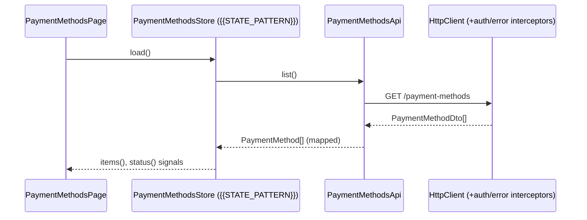

# Design: {{Feature}}

## Impact (from docs/ai/code-index — run prompts/impact-analysis.md first)
| Node | Why affected | Change type | Tests | Human review? |
|---|---|---|---|---|
| {{…}} | {{…}} | {{behaviour/contract}} | {{…}} | {{yes/no}} |
Reuse candidates: {{…}} · Contract changes (stop-and-ask): {{…}}

## Placement (from structure.md)
    {{FEATURE_ROOT}}/payment-methods/
      payment-methods.routes.ts
      pages/payment-methods-page.ts|.html
      ui/payment-method-card.ts, ui/add-card-form.ts
      data-access/payment-methods.store.ts   # or *-facade.ts per architecture.md
      data-access/payment-methods-api.ts
      data-access/payment-method.mapper.ts
      models/payment-method.ts

## Flow


## Model
```ts
export interface PaymentMethod { readonly id: string; readonly brand: 'visa'|'mastercard'|'amex'|'other';
  readonly last4: string; readonly expiry: { month: number; year: number }; readonly isDefault: boolean; }
```

## Store (variant chosen by architecture.md — keep ONE)
- Services + signals (v22): `@Service()` class with private `state = signal<…>()`, `readonly items = computed(…)`; update via set/update, never mutate.
- NgRx SignalStore: `signalStore(withState(...), withMethods(...))` with `rxMethod` for loads.
- NgRx Store: actions `[Payment Methods Page] Opened`, effects calling the API, selectors; `store.selectSignal`.
- Provided at route level (`providers: [PaymentMethodsStore]`) if feature-scoped.

## Page & presentational
- Smart page reads store signals; `@switch (status())`. `payment-method-card`: `method = input.required<PaymentMethod>()`, `makeDefault = output<string>()`, `remove = output<string>()`.

## Form (variant by {{FORMS_STYLE}})
- Signal Forms: `form(model, f => { required(f.holderName); maxLength(f.holderName, 100); })`, `[formField]`.
- Typed Reactive: `nonNullable.group({ holderName: ['', [Validators.required, Validators.maxLength(100)]] })`.

## Errors & a11y
Load error inline with Retry; `role="status"` for loading; dialog focus trap; focus moves to new card on add.

## Testing strategy
| Req | Test |
|---|---|
| 1.x | Page render states (loading/empty/error/list) |
| 2.x | Form validation & duplicate-submit |
| 3.1–3.2 | Store optimistic default + rollback |
| 4.x | Dialog + default-reassignment rule |
| API | `HttpTestingController` per endpoint |

## Open questions needing tech-lead approval
- {{New dependency? PSP wrapper component exists? Feature-scoped vs root store?}}
