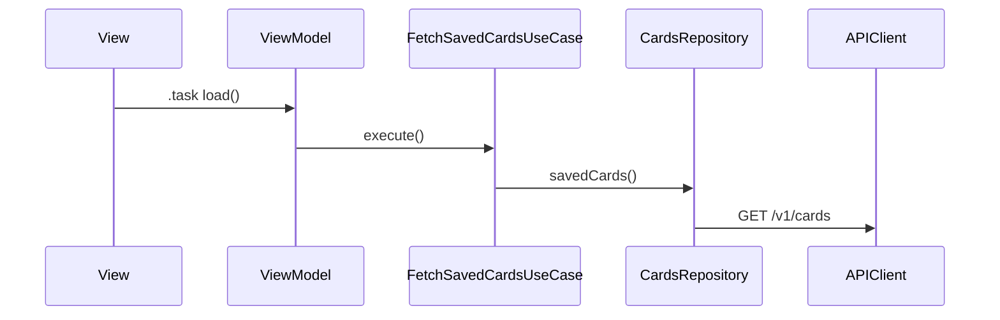

# Design: {{Feature}}
## Impact (from docs/ai/code-index — run prompts/impact-analysis.md first)
| Node | Why affected | Change type | Tests | Human review? |
|---|---|---|---|---|
| {{…}} | {{…}} | {{behaviour/contract}} | {{…}} | {{yes/no}} |
Reuse candidates: {{…}} · Contract changes (stop-and-ask): {{…}}

## Overview
{{3–5 sentences; mirrors exemplar `exemplars.md#orders`}}
## Architecture fit
- Layers: {{PaymentMethodsView + PaymentMethodsViewModel; FetchSavedCardsUseCase; CardsRepository + CardDTO + CardMapper}}
- Modules: {{Features/Payments}} · DI: {{PaymentsAssembly}} · Navigation: {{Route.paymentMethods}}
## Interfaces
```swift
protocol CardsRepository: Sendable { func savedCards() async throws(CardsError) -> [Card] }
```
## Data flow

## API contract · Concurrency & state · Errors · A11y · L10n · Analytics · Flag
{{…}}
## Test mapping
| Req | Test |
|---|---|
| 1.1 | PaymentMethodsViewModelTests.loadsAndSortsCards |
## Open questions needing tech-lead approval
- {{New dependency? Permission? Schema change?}}
